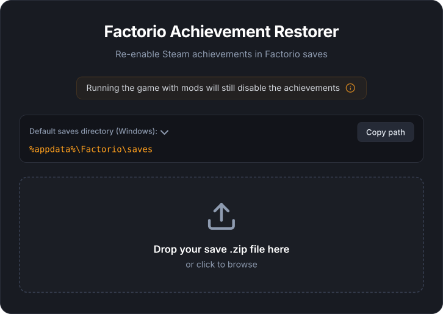

<!-- <h1 align="center">Factorio Achievement Restorer</h1> -->

  

A lightweight online tool to re-enable Steam achievements in Factorio saves after using console commands or the map editor.

Supports all Factorio versions, from 0.17 to 2.1+ with Space Age.
